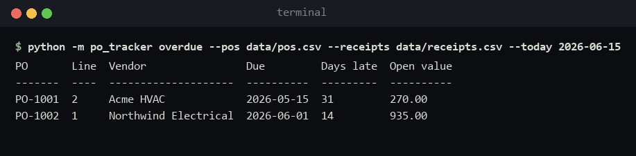

<p align="center"></p>

# purchase-order-tracker

[](https://github.com/yassine2med/purchase-order-tracker/actions/workflows/ci.yml)  

A purchase order stays open until everything on it has arrived, and the open balance is easy to lose track of. This repo loads PO lines and receipts from CSV files into SQLite and answers three questions: what is still open, what is late, and how much is open with each vendor.



## What it is for

Facility coordinators and buyers order filters, panels, valves and parts in many partial deliveries. This tool shows the ordered, received and open quantity and value for every line, lists lines past their due date with days late, and totals the open value per vendor. Data can be kept in a SQLite file so later runs need no CSV files.

## Install

```
git clone https://github.com/yassine2med/purchase-order-tracker
cd purchase-order-tracker && pip install -r requirements.txt
```

## How to use

| I want to | Command |
|---|---|
| Show open balances | `PYTHONPATH=src python -m po_tracker balances --pos data/pos.csv --receipts data/receipts.csv` |
| Include fully received lines | `PYTHONPATH=src python -m po_tracker balances --pos data/pos.csv --receipts data/receipts.csv --all` |
| List overdue lines on a given date | `PYTHONPATH=src python -m po_tracker overdue --pos data/pos.csv --receipts data/receipts.csv --today 2026-06-15` |
| Open value and open lines per vendor | `PYTHONPATH=src python -m po_tracker vendors --pos data/pos.csv --receipts data/receipts.csv` |
| Save the data to a SQLite file | `PYTHONPATH=src python -m po_tracker load --pos data/pos.csv --receipts data/receipts.csv --db po.db` |
| Query a saved file | `PYTHONPATH=src python -m po_tracker overdue --db po.db --today 2026-06-15` |
| Show help | `PYTHONPATH=src python -m po_tracker --help` |

Exit codes: 0 on success, 1 on bad input (missing column, bad date, negative or non-numeric number, or a receipt for a PO line that does not exist). Without `--db` the data lives in memory for one run.

Example:

```
PYTHONPATH=src python -m po_tracker overdue --pos data/pos.csv --receipts data/receipts.csv --today 2026-06-15
```

Output:

```
PO       Line  Vendor                Due         Days late  Open value
-------  ----  --------------------  ----------  ---------  ----------
PO-1001  2     Acme HVAC             2026-05-15  31         270.00
PO-1002  1     Northwind Electrical  2026-06-01  14         935.00
```

Run the tests with `python -m pytest -q`.

## How it works

1. `load` reads both CSV files, checks every row and replaces the contents of the database. A receipt for an unknown PO line is rejected.
2. Balances join PO lines with the sum of their receipts: open quantity is ordered minus received, never below zero, and open value is open quantity times unit price.
3. Overdue lines are open lines whose due date is before the reference date, sorted by days late. The reference date defaults to today.
4. The vendors view adds up open lines and open value per vendor, largest first.

## Limits

- CSV input and SQLite storage only. There is no web screen and no editing of single records.
- Loading replaces all existing data in the database; it does not append.
- The due date belongs to the PO line. Promised dates from the vendor are not tracked.
- Receipts above the ordered quantity count as received but never produce a negative balance, and the lines are not flagged in the printed output.
- One currency, no tax or freight.

## License

MIT. Yassine Emhamed, 2026.
